  

  
  
  
  
  

<h3 align="center">Small tools that do one job well, with the source in the open.</h3>

  A MeridianKit tool reads a public source, gives an agent one capability, or runs a workflow on a schedule. 
  The code lives here. When a tool is worth running on a schedule, its README links to the hosted version.

 

## What we build

  

## How a tool moves

  

## The shape every tool returns

  

Illustration of the output format. Real samples live in each tool's <code>examples/</code> folder.

## Start here

| I want to… | Where it lives |
| :--- | :--- |
| Pull a public dataset | A repository here, and an Apify Actor when it should run on a schedule |
| Give an agent one job | An MCP server or a skill in its own repository |
| See what a tool returns | The `examples/` folder in that repository |
| Run it myself | The source, with the setup steps in its README |

## How we work

<table>
<tr>
<td width="50%" valign="top">

**Public data only** 
Open data, official APIs, and pages that allow it. Nothing behind a login, and nothing a site's terms forbid.

</td>
<td width="50%" valign="top">

**One tool, one job** 
Each repository does a single thing, so it stays small enough to read and easy to trust.

</td>
</tr>
<tr>
<td width="50%" valign="top">

**A real sample first** 
Every README shows actual output before it asks you to run anything.

</td>
<td width="50%" valign="top">

**Source stays open** 
The hosted run is a convenience. The code to run it yourself stays in this account.

</td>
</tr>
</table>

## Status

The first tools are being built now. Each one is added here once it runs from start to finish.

  

  

