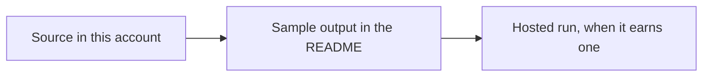

 

  

 

MeridianKit builds small tools that do one job. A tool pulls a public dataset, gives an agent a single capability, or runs a workflow on a schedule.

The source lives in this account. When a hosted run exists, that tool's README links to it.

## Start here

| I want to… | Where it lives |
| --- | --- |
| Pull a public dataset | A repository here, and an Apify Actor when it should run on a schedule |
| Give an agent one job | An MCP server or a skill in its own repository |
| See what a tool returns | The sample in that repository's README |

Tools are added one repository at a time. Nothing is listed here until it actually runs.

## How a tool is shipped

| Piece | What you get |
| --- | --- |
| `README.md` | What it does, one sample, and the hosted link when there is one |
| `src/` | The tool |
| `examples/` | One input and the output it produces |

## Stack

Python for the tools. MCP when an agent needs to call one. Apify when the job should run on a schedule. Docker when the tool needs a fixed environment.

